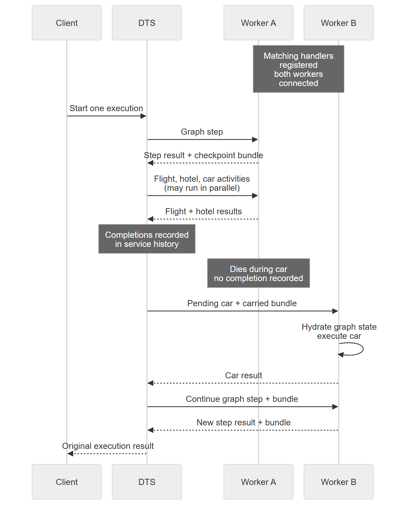

*Keep LangGraph's agent loop. Give its booking tools durable scheduling, recorded results and a worker that can finish the job after another worker disappears.*

## The car is still not booked

Our vacation agent has booked the flight and reserved the hotel. Then its Python process dies halfway through the rental car tool.

In [the previous article](https://www.tamirdresher.com/blog/2026/11/05/langgraph-after-the-crash), we looked at what LangGraph can save in that situation. The normal `create_agent` factory can already preserve completed flight and hotel results when their task writes reach persistent storage. Continuing the same saved thread can leave those bookings alone and run only the unfinished car task.

But there were two different jobs hiding in that sentence: remembering completed work, and getting unfinished work running again. In the directly invoked LangGraph setup, my caller still had to open the saved run and explicitly continue it.

This time, I want to move that second job out of the caller. Each selected booking tool call should become a durable activity. Its input and recorded result should belong to a scheduler that outlives the worker process. If that worker disappears, another eligible worker should receive the pending work without the original caller resending the vacation request.

That is the useful integration between LangGraph and **Durable Task Scheduler (DTS)**. It does not replace LangGraph's checkpointing. It adds durable work delivery and activity history around the execution boundaries we choose.

Let's follow the same flight, hotel and car through the actual Python integration.

---

## Start with the public integration, not an imaginary wrapper

The code lives in [`langchain_azure_compute.graph`](https://github.com/langchain-ai/langchain-azure/tree/8fce92d3a986eddcb5a2718f1c08ca82999adee9/libs/azure-compute/langchain_azure_compute/graph), in the public `langchain-ai/langchain-azure` repository. Its public entry points include `attach_durability`, `durable_tool` and `sdk_options`.

The integration labels its API **public preview and subject to change**. I am using its public source and examples here, not claiming that a package version you already have installed contains this surface. The source manifest declares the `durabletask` optional dependency group, Python 3.11 or later, LangGraph `>=1.0.2,<1.2`, and the Durable Task SDK packages `>=1.13.0,<1.14`. Check those [declared dependencies](https://github.com/langchain-ai/langchain-azure/blob/8fce92d3a986eddcb5a2718f1c08ca82999adee9/libs/azure-compute/pyproject.toml) before combining it with a different LangGraph environment.

The important contract is small: pass a **compiled graph** to `attach_durability`, register the returned handlers on a DTS worker, and use its client wrapper to start a run. Passing an uncompiled `StateGraph` builder is rejected.

Does that include the real `langchain.agents.create_agent` factory from the previous article? Yes. The public source has a [factory integration test](https://github.com/langchain-ai/langchain-azure/blob/8fce92d3a986eddcb5a2718f1c08ca82999adee9/libs/azure-compute/tests/unit_tests/graph/test_step.py#L3594-L3602) with this setup:

```python
from langchain.agents import create_agent

graph = create_agent(
    model=model,
    tools=[write_virtual_file, lookup_kb],
    state_schema=AgentFilesState,
)
reg = attach_durability(graph, name="push_toolnode_v2")
```

This is an excerpt, not a standalone application: that test supplies the fake model, tools, schema and integration imports. It exercises the factory's tool tasks and the integration's tool execution and result commit path. It is source evidence for the factory boundary, not a worker crash experiment.

For the booking walkthrough, I will use the repository's [vacation example](https://github.com/langchain-ai/langchain-azure/blob/8fce92d3a986eddcb5a2718f1c08ca82999adee9/samples/langgraph-durabletask/02_vacation_booking/sample.py). That graph is deliberately hand-built. Its scripted planning node emits the three tool calls, followed by `ToolNode`, review and confirmation nodes. There is no live model or booking provider to distract from the execution mechanism.

---

## The tool remains a LangChain tool

Here is the flight tool, directly from the vacation example:

```python
@durable_tool(retries=3)
@tool
def book_flight(destination: str) -> str:
    """Book a flight to the destination."""
    return record_booking("FLIGHT", destination)
```

Hotel and car use the same decorator arrangement. The sample's `record_booking` appends a fake confirmation to a local log. It is not a real reservation service or a production idempotency implementation.

`@tool` gives LangChain the tool schema and invocation interface. The outer `@durable_tool` adds the durability policy and retry setting. **The decorator does not contact DTS when Python defines the function.** The attached graph's runner interprets that policy when the graph reaches the tool call.

There is another detail worth knowing before you decorate every function in sight: `attach_durability` defaults `durable_tools` to `True`. In that default configuration, supported tools in `ToolNode`s become isolated activities even without an explicit durability decorator. The decorator is useful for making the boundary visible and setting a per-tool policy.

To select tools, the [API](https://github.com/langchain-ai/langchain-azure/blob/8fce92d3a986eddcb5a2718f1c08ca82999adee9/libs/azure-compute/langchain_azure_compute/graph/_api.py#L884-L960) accepts tool names or objects through `durable_tools`, and selector policies through `tool_policy`. An unlisted decorated tool can still become durable through its decorator metadata; the selection list alone does not disable that policy. To force a decorated tool to run locally, set an explicit `"local"` override for that tool in `tool_policy`. Local tools do not get their own durable activity result. In a mixed batch, the runner executes them in the graph step that combines the durable outputs.

The selection matters. A cheap pure calculation and a reservation API do not necessarily deserve the same scheduling boundary.

And `retries=3` is passed to the SDK's `max_number_of_attempts`. It means up to three attempts under that retry policy, not an initial attempt plus three retries. It also is not an exactly-once setting.

---

## Attach, register, then start

The vacation graph ends its builder function with `builder.compile()`, without an external checkpointer. Its worker setup is:

```python
reg = attach_durability(build_vacation_graph(log_path, fail_car_once=True), name="vacation_planner")
worker = DurableTaskSchedulerWorker(**sdk_options(endpoint))
sdk = DurableTaskSchedulerClient(**sdk_options(endpoint))
reg.register(worker)
worker.start()
```

These are exact setup lines from the [sample](https://github.com/langchain-ai/langchain-azure/blob/8fce92d3a986eddcb5a2718f1c08ca82999adee9/samples/langgraph-durabletask/02_vacation_booking/sample.py#L135-L139). It imports `DurableTaskSchedulerWorker` and `DurableTaskSchedulerClient` from the SDK's `durabletask.azuremanaged` worker and client modules, and the three integration functions from `langchain_azure_compute.graph`.

`sdk_options(endpoint)` builds SDK connection options. In a local emulator setup, the endpoint can be `127.0.0.1:8080`. A hosted scheduler also needs the appropriate task hub and authenticated connection configuration. Creating this options dictionary does not create a scheduler or deploy a worker.

Registration binds an orchestration named `langgraph.vacation_planner.run` and activity handlers named `langgraph.vacation_planner.step`, `.tool` and `.node`. The three booking calls share the `.tool` handler, but each has its own scheduled activity invocation and input.

Then the caller starts one run:

```python
client = reg.client(sdk)
run_id = f"vacation-kyoto-{uuid.uuid4().hex[:6]}"
inp = {"messages": [HumanMessage(content="Book trip to Kyoto")], "destination": "Kyoto"}
```

```python
run1 = client.start(inp, instance_id=run_id)
result1 = run1.wait_result(timeout=60)
```

The sample supplies the imports and surrounding `try/finally`, which stops the worker and closes the SDK client. These snippets show lifecycle boundaries, not a replacement for the complete example.

The `instance_id` identifies the DTS execution. By default it also supplies the LangGraph thread identifier; the API allows a separate `thread_id`. Keep those concepts separate when your application has several turns in one conversation.

`wait_result` observes completion. It is not the component driving the graph forward, and its timeout is not a workflow cancellation.

The sample's second `client.start` uses the same instance ID to demonstrate attaching to an existing completed run instead of booking again. That client-level reuse is different from deduplicating an uncertain booking inside an activity.

---

## What actually gets scheduled?

The integration does not execute the entire agent inside a deterministic orchestrator. That would put model calls and booking side effects in replayable orchestration code, which is exactly where they should not be.

Instead, the [runner](https://github.com/langchain-ai/langchain-azure/blob/8fce92d3a986eddcb5a2718f1c08ca82999adee9/libs/azure-compute/langchain_azure_compute/graph/runner.py) separates control from execution.

A graph step activity advances LangGraph to the next boundary. When selected tool calls are pending, its report contains the calls, their packed arguments, checkpoint information and durability policies. The orchestration uses that report to schedule separate tool activities.

Here is the scheduling boundary in the runner:

```python
batch_tasks.append(
    ctx.call_activity(
        state.active_tool_name,
        input=t_req,
        retry_policy=t_retry,
    )
)
```

The surrounding [orchestrator code](https://github.com/langchain-ai/langchain-azure/blob/8fce92d3a986eddcb5a2718f1c08ca82999adee9/libs/azure-compute/langchain_azure_compute/graph/runner.py#L1180-L1260) constructs `t_req` with the thread, checkpoint, tool node, logical call identity, index and packed tool call. In the default checkpoint mode it also carries the graph checkpoint bundle.

The orchestration builds the tasks in a batch before yielding their results. With `tool_max_concurrency=None`, the default, all selected calls in that batch can run in parallel. `tool_max_concurrency=1` schedules them sequentially; larger values bound the batch size. This is the integration's scheduling control, not the claim that LangGraph's own executor concurrency setting creates durability.

After the tool results arrive, another graph step commits them into LangGraph's state and continues the graph. The service can already have recorded flight's activity completion while the graph is still waiting for car. Those are two separate persistence boundaries.

The `.tool` handler executes one tool invocation and returns a packed result. It does not move the dead worker's Python stack into another process.

---

## Two histories, not one

LangGraph's checkpoint describes the graph's state and pending tasks. DTS history records the orchestration's scheduled work and recorded activity outcomes. They answer different questions.

For this vacation example, `attach_durability` supplies an `InMemorySaver` and enables **inline checkpoint bundles** because the compiled graph has no external checkpointer. The in-memory saver alone is not durable. The integration exports a checkpoint slice into graph step results carried through DTS, then hydrates another process's saver from the carried bundle before executing subsequent work.

Here is the recovery mechanism in that specific mode:



[SVG diagram](https://raw.githubusercontent.com/tamirdresher/tamirdresher.github.io/039b3e7d17ad2cc56cc3fb6dea6691b459d7e25e/assets/langgraph-with-dts-durable-tools-and-worker-recovery/worker-recovery.svg) · [Mermaid source](https://raw.githubusercontent.com/tamirdresher/tamirdresher.github.io/039b3e7d17ad2cc56cc3fb6dea6691b459d7e25e/assets/langgraph-with-dts-durable-tools-and-worker-recovery/worker-recovery.mmd)

*Illustrative selected crash window in inline-bundle mode, not a captured log or a serial-tool ordering guarantee. Graph state travels in checkpoint bundles; recorded tool completions belong to logically separate service history and are reused on replay. An already registered, connected and eligible Worker B receives pending work, hydrates the carried state and runs new Python calls—not Worker A's stack. DTS does not provision workers or guarantee exactly-once booking effects. The scheduler must remain available. The client only observes its original execution; it does not start a recovery run.*

The [bundle implementation](https://github.com/langchain-ai/langchain-azure/blob/8fce92d3a986eddcb5a2718f1c08ca82999adee9/libs/azure-compute/langchain_azure_compute/graph/_inline_saver.py) exports the checkpoint slice, pending writes and referenced channel blobs needed for continuation. It is not an unlimited archive of every graph snapshot. State serialization and payload limits are real design constraints.

If you supply a persistent checkpointer instead, `inline_checkpoints` defaults to `False`. That mode keeps graph checkpoints in the external store rather than shipping full bundles. DTS still carries the input, tool calls, activity results and control envelopes. "External checkpointer" does not mean "no application data in DTS."

For another machine to continue in that mode, it needs access to the same durable graph state through a suitable shared storage arrangement. A `SqliteSaver` file on a dead container's private filesystem does not become shared because both workers know its thread ID.

---

## Flight and hotel finished. Worker A disappeared. Now what?

Suppose DTS has recorded the flight and hotel activity completions, but car has not reported completion.

The SDK can replay the orchestration's deterministic control flow using its history. When that flow reaches completed activity calls, their recorded results satisfy the calls without executing the booking bodies again. The unfinished car activity can be delivered again to an eligible worker.

For Worker B, "eligible" is concrete: it runs the graph and tool code, registers the matching handlers, connects to the same scheduler and task hub, and consumes work. DTS does not provision that process for you. If no suitable worker is running, pending work waits.

The [service architecture](https://learn.microsoft.com/en-us/azure/durable-task/scheduler/durable-task-scheduler#app-connectivity) describes work delivery over a gRPC stream. Registering handlers and starting the SDK worker establishes the consumer side. You do not need a caller loop that repeatedly invokes `graph.invoke(None)` to make each recovery happen.

Nor do you need the caller to start a second vacation run. A new client can use `attach_run(instance_id)` to observe the existing execution. Observation and worker delivery are separate responsibilities.

There is still graph execution inside worker activities. "No second caller-issued recovery invocation" does not mean "LangGraph is never invoked after the crash."

### What I actually measured

The earlier crash study included six runs of the Azure graph integration: three kills before car's fake booking effect, and three after its effect but before activity completion. Those used an [earlier public implementation](https://github.com/langchain-ai/langchain-azure/blob/fc96b7d7045bd29290b1a4e8ab7b6c2a3e0dfdaa/libs/azure-compute/langchain_azure_compute/graph/runner.py), a manually constructed graph, LangGraph 1.2.10, SqliteSaver 3.1.2, Durable Task SDK 1.12.0 and a local DTS emulator on Windows.

That setup used a surviving SQLite checkpoint file with inline bundles disabled. The harness supplied the replacement worker. It was not a cross-machine trial, a hosted Azure trial, or a test of the current factory integration and default bundle mode shown above.

In all six runs, flight and hotel executed once, while car's body entered twice. Their recorded DTS completions preceded the kill. There was one client start and no subsequent client start, input resend or caller-issued recovery invocation.

Before car's effect, the final fake booking counts were one flight, one hotel and one car. After car's effect, the final counts were one flight, one hotel and **two cars**.

That last result is not an embarrassing exception to durability. It is the failure window durability must make you design for.

---

## A durable activity can still book two cars

There are two commits that the integration cannot make atomic:

1. The rental provider accepts the reservation.
2. DTS records the activity's completion.

Kill the worker between them and the scheduler has no recorded result to reuse. It delivers the unfinished activity again. The Python function starts again, and the provider may receive the booking again.

The [Python SDK documents at-least-once activity execution](https://github.com/microsoft/durabletask-python/blob/06bb2774c50c6908cb7a5c14e60d04855541f26b/docs/features.md#activities). A single logical scheduled activity can therefore have multiple body attempts. Counting scheduled activities is not the same as counting calls to your provider.

Also separate this from an application exception. The vacation sample deliberately raises a transient car error on its first attempt to demonstrate `RetryPolicy` behavior. A lost worker with no recorded completion is a redelivery problem. A tool that raises and exhausts its configured retry policy is an error-handling problem. The runner also respects whether the tool node handles errors as tool messages or allows failure to propagate.

For real reservations, use a stable **business operation key** across attempts and make the downstream booking contract enforce it atomically. Repeating the same request must return the existing reservation rather than create another one. Validate how the provider handles concurrent duplicates, mismatched request bodies and expired deduplication records. If it cannot provide that contract, plan an explicit reconciliation or compensation protocol for uncertain outcomes.

Generating a fresh key inside each attempt defeats deduplication. Logging the same key twice does not implement it either. The fake booking service in the crash study deliberately did exactly that, and produced two cars.

Your vacation probably needs one car. Your billing system would also appreciate being consulted.

---

## Put the durable boundary where the effect lives

For this agent, the deployment contract is straightforward: keep a scheduler outside the worker's failure boundary, run eligible workers with the registered graph and tool handlers, and choose a graph state mode that those workers can actually recover.

Then put the flight, hotel and car effects behind selected durable tool activities. DTS records their scheduling and completions and delivers unfinished work; LangGraph keeps the state, routing and agent loop. Ordinary code inside a graph step does not automatically become a separately recorded activity just because the graph is attached.

The public repository has the complete [vacation example](https://github.com/langchain-ai/langchain-azure/tree/8fce92d3a986eddcb5a2718f1c08ca82999adee9/samples/langgraph-durabletask/02_vacation_booking) and a separate [two-process checkpoint-bundle example](https://github.com/langchain-ai/langchain-azure/tree/8fce92d3a986eddcb5a2718f1c08ca82999adee9/samples/langgraph-durabletask/09_two_process_crash_recovery). The latter uses an approval interrupt and an explicit human response, not the same mid-booking failure scenario. Neither should be confused with the [native LangGraph crash reproduction](https://github.com/tamirdresher/langgraph-internals-samples/tree/main/crash-recovery).

The practical question is no longer just "can I reopen this checkpoint?" It is "who owns the pending booking, where is its recorded result, and what happens if the provider accepted it before my worker disappeared?"

**Let the scheduler own delivery. Let LangGraph own graph state. Make the booking provider own duplicate suppression.** Those three responsibilities fit together. None of them disappears behind a decorator.
