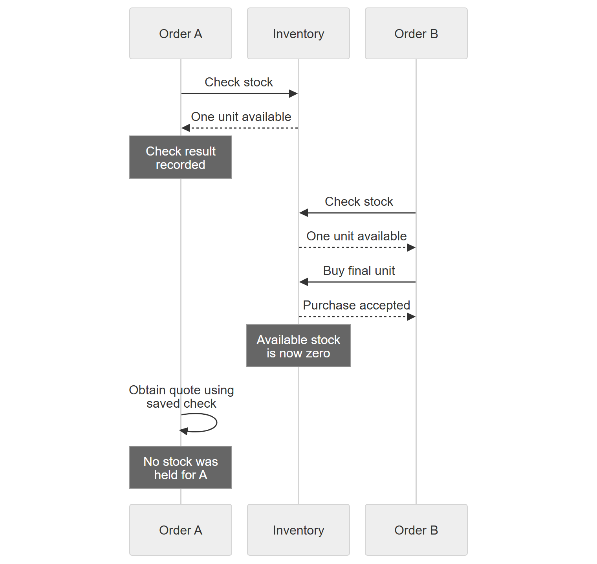

I had an interesting conversation with a friend about durable workflows, and it made me realize how easy it is to confuse what an orchestration remembers with what it guarantees about side effects and the state of the world around it.

Let's make that concrete. Suppose you want a durable orchestration for purchasing a product.

If you're the shop owner handling this at the counter, you might check the customer's request, find the item, set it aside, and give them a price before completing the purchase. Setting it aside matters: you're holding that actual item for this customer while you finish.

The naive translation into activities looks reasonable: **ValidateOrder → CheckStock → ObtainQuote**, then complete the purchase. But we've lost something in translation. `CheckStock` reads availability. It doesn't put anything behind the counter.

The check returns yes, its successful result gets recorded, and the orchestration continues. Meanwhile, another customer buys the last unit. Our workflow can still produce a quote using that earlier answer.

If we treat that answer as a promise of availability, we have a serious bug. Making the workflow durable doesn't reserve the item, keep external state unchanged, or make its side effects happen exactly once.

Replay makes the distinction easier to notice because it reuses recorded results. But orchestration didn't create the race. It exists even without replay or a crash. A physical shop has the same problem if two people merely check the shelf without holding anything.

**Remembering a successful stock check is not the same as owning the stock.** The question is what our purchase flow needs instead.

---

## What did the stock check actually tell us?

Let's keep the example small. Two customers want the same product. There's one unit left.

Order A asks inventory whether the product is available. Inventory answers yes. Order B asks the same question before either order has acquired anything. Inventory can honestly answer yes again.

Neither response is wrong. They describe availability at the time of each read.

Here's one possible interleaving:



[SVG diagram](https://raw.githubusercontent.com/tamirdresher/tamirdresher.github.io/2a8b9216ebbb2f193d51394b02b7eb1c4d9e792c/assets/durable-workflows-external-state-consistency/stock-race.svg) · [Mermaid source](https://raw.githubusercontent.com/tamirdresher/tamirdresher.github.io/2a8b9216ebbb2f193d51394b02b7eb1c4d9e792c/assets/durable-workflows-external-state-consistency/stock-race.mmd)

*Illustrative interleaving, not a measured trace. Order A can continue with an accurate record of an earlier answer and an incorrect assumption about current availability. No crash is required.*

If Order A treats its earlier check as permission to sell, and nothing at the final write enforces the stock limit, we can oversell. If inventory correctly rejects the final purchase, we avoid overselling, but Order A still cannot promise availability based on that check.

That distinction matters. The problem isn't necessarily a corrupted stock counter. It can be a customer promise our workflow never had the authority to make.

This is the ordinary check-to-use race. Something can change between observing a condition and acting on it. Durable execution doesn't create the gap, and removing durable execution doesn't close it.

Here's what that first version looks like in C# with the Durable Task SDK.

```csharp
public sealed class CheckThenQuote : TaskOrchestrator<PurchaseAttempt, Quote?>
{
    public override async Task<Quote?> RunAsync(
        TaskOrchestrationContext context, PurchaseAttempt order)
    {
        await context.CallActivityAsync("ValidateOrder", order);
        bool available = await context.CallActivityAsync<bool>("CheckStock", order);
        if (!available)
            return null;

        return await context.CallActivityAsync<Quote>(
            "ObtainQuote", new QuoteRequest(order, ReservationId: null));
    }
}
```

`PurchaseAttempt` carries an order ID, a stable attempt ID, the SKU, and quantity. `QuoteRequest` carries that attempt and an optional reservation ID. Returning a quote here is perfectly valid if it's only indicative. The bug appears when the caller interprets it as a promise that stock is held. Nothing in this orchestration acquired that right.

Both this example and the alternative below stop short of checkout: the quote hasn't been accepted, no payment is taken, and no completed order is recorded.

---

## Replay remembers the answer, not the world

The public [Durable Orchestrations overview](https://learn.microsoft.com/en-us/azure/durable-task/common/durable-task-orchestrations#reliability) explains the recovery model: execution history lets an orchestration reconstruct its progress. When replay reaches an activity whose successful result is already recorded, it uses that result rather than running the activity again to discover a new answer.

For our stock check, the recorded answer means: inventory reported availability when this activity ran.

It doesn't mean: inventory is still available whenever we happen to use this result.

I find it helpful to separate three questions:

* **Durability:** Can the workflow recover its recorded progress?
* **Freshness:** How recently did we observe this external state?
* **Business consistency:** Can competing operations violate the rule we're trying to protect?

A saved result can be durable and old. A fresh result can become outdated before the next request. Neither result, by itself, prevents two orders from claiming one unit.

The orchestration history belongs to this workflow. The stock belongs to inventory. Recording an answer in the first system doesn't acquire a right in the second.

That's the boundary I care about here. The workflow can reliably remember what happened without making external business state stand still.

---

## Checking again moves the gap

My first question when looking at this kind of flow is usually: why not recheck immediately before the operation that matters?

Sometimes we should. A newer read can save us from doing unnecessary work. But we need to be precise about what it fixes.

Suppose Order A rechecks, gets yes, and then sends a purchase request. Order B can still acquire the final unit between those two requests. We've shortened the window, not removed it.

Putting both calls inside one activity doesn't change that. An activity containing "read availability, then purchase" still makes two separate calls unless the receiving service supplies an atomic operation. A method boundary isn't a transaction boundary.

The same applies to a version number. Reading stock at version 12 is useful if the final write says "apply this only if the version is still 12" and the inventory owner enforces that condition atomically with the update. Passing the number around without enforcing it doesn't protect anything.

So I stop asking how close together I can place the calls and ask a different question:

**Which component can check the rule and change the protected state as one indivisible decision?**

In this example, that's the inventory owner.

It could use a local database transaction, a conditional write, or serialized access to authoritative stock. The implementation depends on its storage and concurrency model. The requirement doesn't: competing orders must not both acquire the same available unit.

All paths that allocate stock have to honor that rule. A careful workflow can't protect inventory if another checkout path bypasses the same controls.

---

## If we're promising stock, ask for a reservation

For a product that promises availability while the customer reviews a quote, I'd change the business operations, not just rearrange the reads.

The illustrative sequence becomes **ValidateOrder → ReserveStock → ObtainQuote → ConfirmReservation**. These are application-owned operations, not Durable Task SDK APIs.

Validation checks the order's inputs and rules. It doesn't hold inventory.

Reservation is different. The inventory service atomically checks available stock and creates a hold against it. Its response includes a reservation identity and an expiry. A successful response now gives the workflow something more useful than an observation: a specific, time-bounded claim on inventory.

If Order A gets the last unit reserved, Order B's competing reservation must fail, wait, or follow some other explicit business policy. It must not get an equivalent claim on that same unit.

The quote is associated with that reservation. Later, confirmation asks inventory to atomically validate and consume the still-active, unexpired hold. The successful confirmation is the inventory decision, not an earlier `if` statement in the orchestrator.

Notice what changed. The workflow no longer interprets "I saw stock" as "I can sell stock." It carries an identity that inventory understands and can enforce.

And notice what didn't change. Stock, pricing, payment, and the order record haven't become one ACID transaction. We've given inventory a local invariant and made the workflow coordinate around it. The [Saga pattern's discussion of data anomalies](https://learn.microsoft.com/en-us/azure/architecture/patterns/saga#potential-data-anomalies-in-sagas) is worth reading here: there is no built-in isolation across the participating services.

If all the data and rules genuinely fit in one local transaction, use that boundary. A durable workflow isn't a reason to split an atomic business operation into several unsafe ones.

Here's the changed orchestration. The important difference isn't another SDK feature. It's which business operation we ask the activity to perform, and which identity we carry into the next call.

```csharp
public sealed class ReserveThenQuote : TaskOrchestrator<PurchaseAttempt, InventoryOutcome>
{
    public override async Task<InventoryOutcome> RunAsync(
        TaskOrchestrationContext context, PurchaseAttempt order)
    {
        await context.CallActivityAsync("ValidateOrder", order);
        var retry = TaskOptions.FromRetryPolicy(new RetryPolicy(
            maxNumberOfAttempts: 3, firstRetryInterval: TimeSpan.FromSeconds(2)));
        var ids = AttemptOperations.For(order);

        Reservation? hold = await context.CallActivityAsync<Reservation?>(
            nameof(ReserveStock), new ReserveRequest(order, ids.Reserve), retry);
        if (hold is null)
            return new InventoryOutcome("Unavailable", null, null);

        Quote quote = await context.CallActivityAsync<Quote>(
            "ObtainQuote", new QuoteRequest(order, hold.ReservationId));

        Confirmation decision = await context.CallActivityAsync<Confirmation>(
            nameof(ConfirmReservation),
            new ConfirmRequest(hold.ReservationId, ids.Confirm), retry);

        return new InventoryOutcome(
            decision.Confirmed ? "InventoryConfirmedOnly" : "HoldExpiredOrRejected",
            hold, quote);
    }
}
```

`Reservation` contains a `ReservationId` and `ExpiresAt`. `Quote` contains its own `QuoteId`, `Amount`, `Currency`, and `ValidUntil`. `InventoryOutcome` carries a status, the hold, and that still-unaccepted quote. I called the successful status `InventoryConfirmedOnly` deliberately: this code allocates inventory, not a completed purchase. Authoritative quote acceptance, payment, and order completion still need their own contracts and recovery paths.

The retry policy handles activity failures, not ordinary business rejection. It neither deduplicates an external effect nor renews a hold. There's no quote retry policy in this sketch; if obtaining a quote has side effects or promises stable offer terms, pricing needs its own operation identity and retry contract too.

These classes are design alternatives for **new flows**, registered under different orchestration names. Don't replace the activity sequence of an in-flight replaying instance with the new one. Its recorded history must remain compatible with the code that replays it; a deployed change needs a deliberate versioning or migration strategy.

### The activity delegates the decision, not just the HTTP calls

The corresponding activities use the SDK's `TaskActivity<TInput, TOutput>` shape. An injected `IInventoryOwner` represents our inventory service or gateway:

```csharp
public sealed class ReserveStock : TaskActivity<ReserveRequest, Reservation?>
{
    private readonly IInventoryOwner inventory;
    public ReserveStock(IInventoryOwner inventory) => this.inventory = inventory;

    public override Task<Reservation?> RunAsync(
        TaskActivityContext context, ReserveRequest request)
        => inventory.TryReserveAtomicallyAsync(request);
}

public sealed class ConfirmReservation : TaskActivity<ConfirmRequest, Confirmation>
{
    private readonly IInventoryOwner inventory;
    public ConfirmReservation(IInventoryOwner inventory) => this.inventory = inventory;

    public override Task<Confirmation> RunAsync(
        TaskActivityContext context, ConfirmRequest request)
        => inventory.ConfirmAtomicallyAsync(request);
}
```

Those method names are a contract we have to implement, not atomicity supplied by the SDK. Here's the relevant part of our application interface:

```csharp
public interface IInventoryOwner
{
    // At the INVENTORY OWNER, in one atomic decision across concurrent callers:
    // deduplicate OperationId, enforce availability, create the hold, and persist the
    // operation outcome together. Return null for no stock. Exact duplicates return
    // their established outcome, not another hold; reject changed payloads for a key.
    // All allocating paths must enforce the same inventory invariant.
    Task<Reservation?> TryReserveAtomicallyAsync(ReserveRequest request);

    // Atomically deduplicate, verify reservation ownership and ACTIVE/unexpired state
    // using the owner's clock, consume the hold, and persist the operation outcome.
    // Serialize against expiry/reclamation. A repeated successful confirm returns its
    // established success even if the original deadline has now passed.
    Task<Confirmation> ConfirmAtomicallyAsync(ConfirmRequest request);
}
```

`ReserveRequest` combines the purchase attempt with its operation key. `ConfirmRequest` combines the reservation ID with a different operation key, bound to the intended order and attempt. `Confirmation` carries the owner's `Confirmed` decision.

The gateway can make a network call, but the atomic decision must happen at the inventory owner. Implementing `TryReserveAtomicallyAsync` as two unprotected requests, first checking availability and then creating a hold, would recreate the original bug with a more reassuring method name.

---

## The reservation has a clock. So does the quote.

A reservation introduces a new question: what if the workflow continues after the hold expires?

Perhaps obtaining the quote took longer than expected. Perhaps the customer went away. Perhaps the workflow recovered after an interruption. The reason doesn't change what inventory must do.

When confirmation arrives, inventory checks the authoritative reservation state and expiry as part of the same operation that consumes the hold. It must resolve the race between confirmation and expiry there.

Checking the expiry in the orchestrator and then calling inventory isn't enough. The hold can expire between those steps, just as stock could disappear between our original check and purchase.

A durable timer can wake the workflow to notify the customer or request cancellation. It isn't the authority deciding whether an expired hold can still be consumed, and inventory must not depend on that timer firing before it treats the hold as expired.

There's also a separate contract hiding inside "obtain a quote."

Holding the product doesn't necessarily hold its price. A quote may have its own identity, validity period, and acceptance rules. If the inventory hold remains valid but the quote has expired, that isn't automatically permission to charge the old price. If the quote remains valid but the hold expired, it doesn't recreate the missing stock.

The application has to define how those promises fit together before it tells the customer the order is confirmed. Payment authorization adds another boundary, not a shortcut around these two.

For an expired hold, I'd make the next step explicit: reject confirmation, or deliberately start a new reservation attempt and obtain a new quote when the pricing contract requires it. Don't silently pretend that a new attempt is the continuation of an old promise.

---

## Idempotency solves a different competition

We still need retry-safe operations.

The public [programming model's Activities section](https://learn.microsoft.com/en-us/azure/durable-task/common/programming-model-overview#activities) describes at-least-once execution. An activity can complete its external effect and then fail before its completion is recorded. That activity may run again.

Imagine inventory created the reservation, but the activity's completion wasn't recorded. Repeating the reservation request must not hold another unit.

For that, the same logical reserve operation needs a stable idempotency key. The inventory owner needs to recognize the repeated operation and return its established outcome without applying another reservation effect.

This is not a separate "look up the key, then write the reservation" sequence with no concurrency protection. Two executions can both pass the lookup. The deduplication decision and the inventory change need atomic service-side enforcement. The public [Idempotent Consumer pattern](https://learn.microsoft.com/en-us/azure/architecture/patterns/idempotent-consumer#commit-the-processed-key-and-the-side-effects-atomically) explains the atomicity requirement and the need to guard against concurrent duplicates.

I'd give reserve, confirm, and release separate operation identities, all correlated to the order and reservation attempt. Retrying reserve keeps its reserve identity. Confirm doesn't borrow that identity as a generic "order key." A deliberately new attempt after expiry gets a new identity rather than being mistaken for a retry of the old reservation. Generating a fresh key for every retry defeats the point.

That's what `AttemptOperations.For` in the orchestration produces:

```csharp
public sealed record PurchaseAttempt(
    string OrderId, string AttemptId, string Sku, int Quantity);

public sealed record OperationKey(string OrderId, string AttemptId, string Operation);
public sealed record AttemptOperations(
    OperationKey Reserve, OperationKey Confirm, OperationKey Release)
{
    public static AttemptOperations For(PurchaseAttempt order) => new(
        new(order.OrderId, order.AttemptId, "reserve"),
        new(order.OrderId, order.AttemptId, "confirm"),
        new(order.OrderId, order.AttemptId, "release"));
}
```

The caller supplies and persists `AttemptId` before scheduling the orchestration. Recovery reuses it; a deliberate fresh reservation attempt gets a new one. These structured keys distinguish operations without relying on ambiguous string concatenation; their transport encoding is omitted.

Retrying reserve returns its established reservation and original expiry, even if that hold has since expired. It doesn't secretly create a new hold. Similarly, if confirmation already succeeded but its response was lost, retrying that same confirmation returns the recorded success rather than trying to consume the hold again.

But don't confuse this with the last-item race.

Order A and Order B are two legitimate operations with different keys. Deduplication should accept that they're different. The stock invariant decides which one can acquire the remaining unit.

**Idempotency stops the same operation from taking effect twice. Inventory concurrency control stops different operations from taking the same stock.** A design can get the first right and still oversell because it never implemented the second.

---

## Who releases the hold if nobody comes back?

Now suppose the quote fails, the customer cancels, or the workflow cannot proceed. We need an explicit release operation.

The code above intentionally shows only the inventory happy path. It omits the release activity and caller, quote-failure recovery, cancellation handling, and escalation. A release request would use `ids.Release` and ask the owner to release only an active, releasable hold, with a persisted retry-stable outcome. Production code needs those recorded recovery paths; a cleanup failure must not hide the original error.

Durability doesn't author that business action for us. Nor should we assume workflow cleanup will always run: termination can prevent the workflow from reaching its release logic.

That's why inventory needs its own expiry and reclamation behavior for abandoned holds. A reservation must stop blocking availability according to the owner's policy even if this workflow never sends another message.

Release also has to be retry-safe and aware of the reservation's current state. A late release request must not turn a confirmed purchase back into available stock. Blindly incrementing a stock counter is not compensation.

This is where I think the word "rollback" can make the design sound easier than it is. We aren't restoring the world to a snapshot. Other orders have continued. A confirmed reservation may require a cancellation or return process with different rules.

The [Compensating Transaction pattern](https://learn.microsoft.com/en-us/azure/architecture/patterns/compensating-transaction#solution) makes that distinction explicit: compensation is business-specific, must account for concurrent work, and can itself fail. We need recorded recovery progress and an escalation path when automated recovery can't resolve the state.

For our example, "release this active hold if it is still releasable" is a meaningful domain action. "Undo whatever happened" is not a contract.

---

## Maybe we shouldn't hold stock yet

There's a perfectly reasonable alternative to this reservation flow: don't promise availability while producing the quote.

If the product offers an indicative quote, a stock check can remain just a stock check. The customer sees an estimate, with availability subject to final confirmation. The inventory owner still atomically validates and allocates stock at purchase time, and out-of-stock is an expected business outcome.

That can be a better design than holding scarce inventory for every person browsing a cart.

Reservations have costs. Long holds exclude other customers. Short holds can expire while someone is still deciding. Renewals need their own rules. A busy product can spend much of its availability sitting in abandoned carts.

So I wouldn't start with "always reserve." I'd start with what the customer is being promised.

If the promise is "here's an estimate," design for a possible rejection later. If the promise is "this item is yours until the stated deadline," the system needs an enforceable hold behind those words.

The workflow should implement the promise we've chosen, not accidentally invent a stronger one because an activity returned `true`.

---

## The boundary I want to see in the design

When I look at this order flow now, I don't start by asking whether each step survives a restart. I want that, but it answers only part of the question.

I also want to know what each successful result permits the next step to assume. Is it a historical observation? A quote with terms? An active reservation? A completed purchase?

Then I look for the owner that enforces each promise when the state changes. Inventory arbitrates stock. Pricing defines quote validity. The workflow carries their identities, handles their outcomes, and makes recovery decisions across those boundaries.

That gives durability something sound to preserve.

The orchestration can remember that stock was available. Only the inventory contract can turn that into a right to use it.
